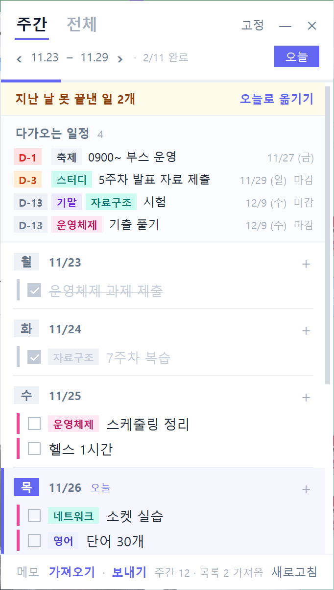
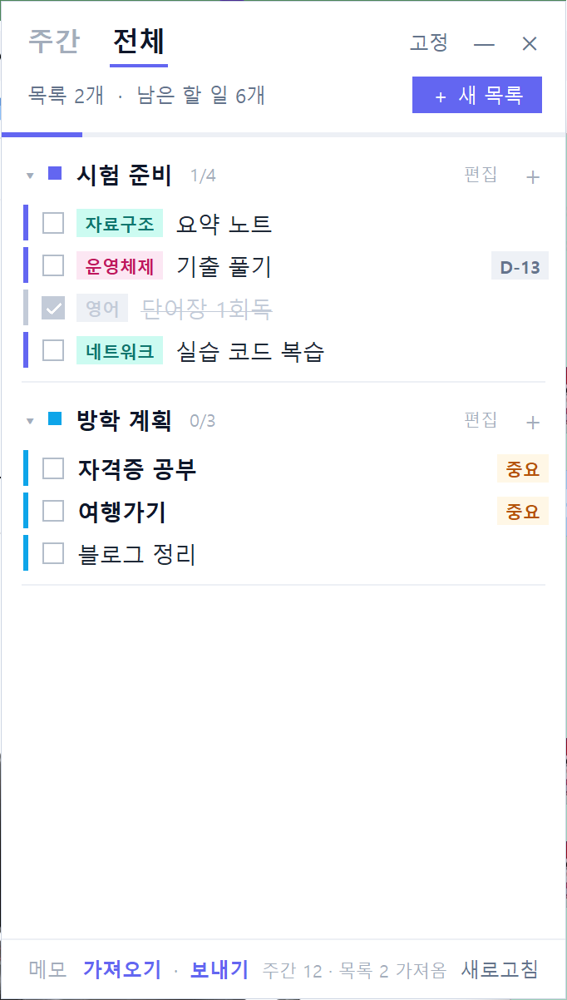
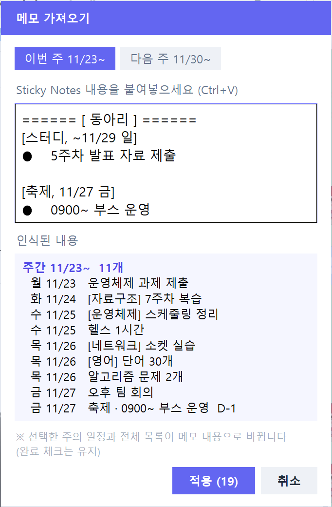
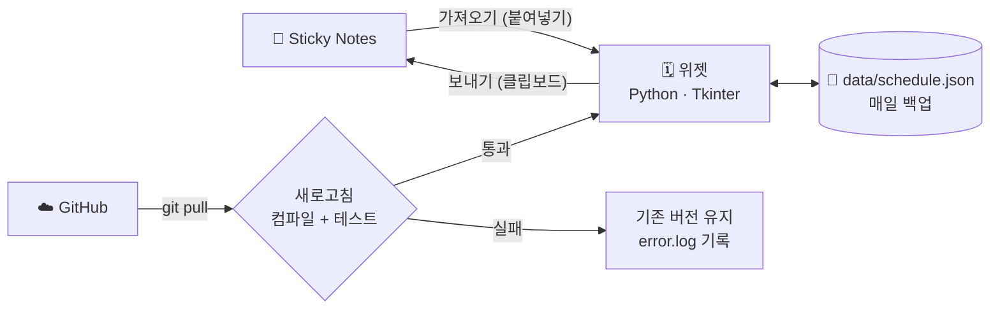

<div align="center">

# 📅 주간 일정 위젯

**바탕화면 오른쪽 아래에 조용히 떠 있는 가벼운 주간 일정 위젯**<br>
Sticky Notes에 쓰던 그대로 붙여넣으면 주간 일정 · D-day · 할 일 목록으로 정리됩니다.


**[⚡ 바로 설치](#-지금-설치하기)** · [사용 방법](#-사용-방법) · [메모 작성 규칙](#-메모-작성-규칙) · [기술 스택](#-기술-스택) · [문제 해결](#-문제-해결)

  

<sub>주간 탭 · 전체 탭 · 메모 가져오기 &nbsp;(예시 데이터)</sub>

</div>

---

## ✨ 이런 걸 할 수 있어요

| | 기능 | 설명 |
|:-:|---|---|
| 🗓️ | **주간 보기** | 월~일을 한눈에. 빈 날은 한 줄로 접히고, 오늘은 강조되고, 열면 오늘로 스크롤 |
| 📋 | **Sticky Notes 연동** | 메모를 붙여넣으면 자동 정리 → 위젯에서 바꾼 내용은 다시 **메모 형식으로 복사** |
| ⏰ | **D-day** | `[과제, ~11/29]` 같은 마감에 `D-3` 배지, 위쪽 **다가오는 일정**에 모아 보기 |
| 🏷️ | **과목 태그** | `[알고리즘] 복습` → 색 태그 (같은 과목은 항상 같은 색) |
| 📚 | **전체 목록** | 기말고사 준비, 방학 계획처럼 날짜 없는 할 일은 `전체` 탭에 |
| ↪️ | **미루기 · 이월** | 우클릭으로 내일 / 다음 주로, 못 끝낸 일은 버튼 한 번에 오늘로 |
| 📈 | **진행률** | 이번 주 `3/12 완료` + 진행 막대 (다 끝내면 초록색) |
| ⌨️ | **단축키** | <kbd>Ctrl</kbd>+<kbd>Alt</kbd>+<kbd>W</kbd> 로 언제든 불러오기, <kbd>Win</kbd>+<kbd>D</kbd> 를 눌러도 남아 있음 |
| 🔄 | **자동 업데이트** | GitHub에 새 버전이 올라오면 다시 설치할 필요 없이 알아서 반영 |
| 🛡️ | **데이터 보호** | 매일 자동 백업 · 파일이 깨지면 자동 복구 · 새 버전이 고장 나면 이전 버전으로 |

---

## 📖 사용 방법

### 1️⃣ 설치

맨 아래 **[⚡ 지금 설치하기](#-지금-설치하기)** 의 링크 하나면 끝. 설치가 끝나면 화면 **오른쪽 아래**에 위젯이 뜨고, 다음부터는 컴퓨터를 켤 때 자동으로 실행됩니다.

### 2️⃣ Sticky Notes 메모 가져오기

1. Sticky Notes에서 메모 전체 선택 후 복사 — <kbd>Ctrl</kbd>+<kbd>A</kbd> → <kbd>Ctrl</kbd>+<kbd>C</kbd>
2. 위젯 아래쪽 **`메모 · 가져오기`** 클릭 (복사한 내용이 자동으로 채워짐)
3. 넣을 주를 고르고 (`이번 주` / `다음 주`) — 인식된 항목을 **미리보기로 확인**
4. **`적용`**

> [!TIP]
> 다시 가져와도 **이미 체크한 항목은 그대로 유지**됩니다. 메모를 고칠 때마다 편하게 다시 가져오세요.

### 3️⃣ 위젯에서 관리하기

| 하고 싶은 것 | 방법 |
|---|---|
| 완료 체크 | 항목 왼쪽 체크박스 클릭 |
| 내용 고치기 · 삭제 | 항목 글자 클릭 |
| 내일로 미루기 · 다음 주로 · 오늘로 | 항목 **우클릭** |
| 못 끝낸 일 오늘로 | 위쪽 노란 막대의 `오늘로 옮기기` |
| 일정 추가 | 날짜 오른쪽 `＋` |
| 날짜 없는 할 일 | `전체` 탭 → `＋ 새 목록` / 목록의 `＋` |
| 위젯 불러오기 | <kbd>Ctrl</kbd>+<kbd>Alt</kbd>+<kbd>W</kbd> (한 번 더 누르면 다시 뒤로) |

### 4️⃣ 메모로 돌려보내기

아래쪽 **`메모 · 보내기`** → 메모 형식 그대로 클립보드에 복사됨 → Sticky Notes에서 <kbd>Ctrl</kbd>+<kbd>A</kbd> → <kbd>Ctrl</kbd>+<kbd>V</kbd>.
완료한 항목은 `✓` 가 붙어서, 다시 가져와도 완료로 인식됩니다.

<details>
<summary><b>🖱️ 모든 버튼 · 조작 한눈에 보기</b></summary>

<br>

| 위치 | 버튼 | 기능 |
|---|---|---|
| 위 | `주간` `전체` | 주간 일정 / 날짜 없는 목록 전환 |
| 위 | `‹` `›` · `오늘` | 이전 · 다음 주 / 이번 주로 |
| 위 | `고정` | 항상 맨 위에 고정 |
| 위 | `—` · `✕` | 접기 (제목과 진행 막대만) · 종료 |
| 위 | 제목 줄 드래그 | 위치 이동 (기억됨) |
| 본문 | 다가오는 일정 행 클릭 | 그 주로 이동 (목록 항목이면 전체 탭) |
| 본문 | 목록 이름 클릭 · `편집` | 접기/펼치기 · 이름 변경/삭제 |
| 아래 | `메모 · 가져오기` / `보내기` | Sticky Notes ↔ 위젯 |
| 아래 | `새로고침` | 최신 버전 받아서 다시 불러오기 |

</details>

---

## 📝 메모 작성 규칙

평소 Sticky Notes에 쓰던 방식 그대로입니다. **`=` 줄은 주간, `-` 줄은 전체 목록** 하나만 기억하면 됩니다.

```text
====== [ 학교 일정 ] ======          ← 주간 섹션 (이름이 카테고리 색이 됨)
<수요일>
⦁    [운영체제] 스케줄링 정리         ← [과목] = 색 태그
⦁    ✓ 네트워크 과제                 ← ✓ = 완료
<목요일>
⦁    알고리즘 문제 2개 **             ← ** = 중요 (굵게)
⦁    -                               ← 빈 자리는 무시

====== [ 동아리 ] ======
[스터디, ~11/29 일]                  ← ~ 가 붙은 날짜 = 마감 (D-day)
⦁    발표 자료 제출
[축제, 11/27 금]                     ← ~ 없으면 그날의 일정
⦁    0900~ 부스 운영

---- [ 시험 준비 ] ----               ← 날짜 없는 전체 목록
⦁    [자료구조] 요약 노트
⦁    [운영체제] 기출 풀기 ~12/9       ← 목록 항목의 마감일
```

<details>
<summary><b>📐 규칙 전체 표</b></summary>

<br>

| 쓰는 법 | 의미 |
|---|---|
| `====== [ 이름 ] ======` | 주간 섹션 — 이름이 카테고리(색)가 됨 |
| `<월요일>` … `<일요일>` | 그 요일의 할 일 (가져올 때 고른 주에 배치) |
| `[라벨, 11/27 금]` | 그 날짜의 일정 — 라벨이 태그로 표시 |
| `[라벨, ~11/29 일]` | `~` = 마감, D-day 배지 |
| `---- [ 이름 ] ----` | 날짜 없는 전체 목록 |
| `⦁ [과목] 내용` | 과목 색 태그 |
| `⦁ 내용 ~12/15` | (전체 목록) 마감일 |
| `⦁ 내용 **` · `⦁ *내용*` | 중요 표시 |
| `⦁ ✓ 내용` | 완료된 항목 |
| `⦁ -` | 빈 자리표시 (무시) |

- 글머리표는 `⦁` `•` `-` `*` `●` `1.` 등 대부분 인식합니다.
- 연도는 오늘과 가까운 해로 자동 판단합니다. 이번 주가 아닌 날짜도 그 날짜에 저장되어 D-day가 계속 줄어듭니다.

</details>

---

## 🧱 기술 스택

| 영역 | 사용한 기술 | 선택한 이유 |
|---|---|---|
| 언어 | **Python 3.13** (표준 라이브러리만) | `pip install` 없이 바로 실행 |
| 화면 | **Tkinter** (Tk 8.6) | Python 내장 · 메모리 약 45MB로 가벼움 |
| Windows 연동 | **ctypes + Win32 API** | 고해상도 화면 선명도(DPI), 중복 실행 방지(Mutex), 전역 단축키(`RegisterHotKey`), 창 순서(`SetWindowPos`) |
| 저장 | **JSON** | 사람이 읽을 수 있는 한 파일 · 원자적 저장 + 매일 백업 |
| 자동 시작 | **시작프로그램 바로가기** | 관리자 권한 불필요 |
| 업데이트 | **Git** (`pull --ff-only`) | 코드가 바뀌면 컴파일 + 테스트를 통과할 때만 재시작 |
| 테스트 | **unittest** | 메모 파서 · 메모 왕복 · 백업/복구 · 이월 등 17개 |
| 설치 | **PowerShell + winget** | 한 줄 설치, Python · Git이 없으면 설치까지 |

### 어떻게 동작하나요?



<details>
<summary><b>🛡️ 안전장치 자세히</b></summary>

<br>

| 상황 | 위젯이 하는 일 |
|---|---|
| 매일 | 그날 처음 저장하기 전 상태를 `data/backups/` 에 보관 (최근 14일) |
| 일정 파일이 깨짐 | 지우지 않고 `schedule.corrupt-*.json` 으로 남기고, 최신 백업에서 자동 복구 + 안내 표시 |
| 화면에 안 보이는 오류 | 전부 `data/error.log` 에 기록 |
| 새 버전이 테스트 실패 | 재시작하지 않고 지금 버전 유지 |
| 새 버전이 시작하다 죽음 | 마지막으로 정상 동작한 버전(`data/fallback/`)이 대신 실행 + 빨간 안내 |
| 같은 위젯을 두 번 실행 | 두 번째는 뜨지 않음 |

> [!NOTE]
> 개인 일정은 전부 `data/` 폴더에만 저장되고 **GitHub에는 올라가지 않습니다.**

</details>

---

## ❓ 문제 해결

<details>
<summary><b>위젯이 안 보여요</b></summary>

<br>

1. <kbd>Ctrl</kbd>+<kbd>Alt</kbd>+<kbd>W</kbd> 로 불러오기
2. 그래도 없으면 설치 폴더의 `start_widget.bat` 실행
3. 계속 안 뜨면 `data/error.log` 를 확인하세요

</details>

<details>
<summary><b><code>새로고침</code> 을 눌렀는데 아래에 메시지가 떠요</b></summary>

<br>

| 메시지 | 뜻 |
|---|---|
| 이미 최신 버전 | 바뀐 코드가 없음 |
| 새 버전 적용 · 재시작 | 정상 — 잠시 후 새 버전으로 다시 뜸 |
| 새 코드 검사 실패 | 새 버전이 테스트를 통과하지 못해 지금 버전 유지 (`error.log` 참고) |
| 깃허브 확인 실패 | 인터넷 또는 Git 문제 — 위젯은 정상 동작 |
| 충돌로 받기 실패 | 설치 폴더의 코드를 직접 고친 경우 — `update.bat` 로 확인 |

</details>

<details>
<summary><b>일정이 사라졌어요 / 며칠 전 상태로 되돌리고 싶어요</b></summary>

<br>

1. 위젯을 `✕` 로 끕니다
2. `data/backups/` 에서 원하는 날짜의 `schedule-YYYY-MM-DD.json` 을 골라
3. `data/schedule.json` 으로 복사(덮어쓰기)한 뒤 위젯을 다시 실행

</details>

<details>
<summary><b>ZIP으로 받은 <code>setup.bat</code> 을 실행하니 "Windows의 PC 보호" 경고가 떠요</b></summary>

<br>

인터넷에서 받은 배치 파일이라 뜨는 일반적인 경고입니다. **추가 정보 → 실행** 을 누르면 됩니다.
경고 없이 설치하려면 [PowerShell 한 줄 설치](#-지금-설치하기)를 쓰세요.

</details>

<details>
<summary><b>자동 시작을 끄거나 완전히 지우고 싶어요</b></summary>

<br>

- 자동 시작만 끄기: `uninstall_autostart.bat`
- 완전히 지우기: 위젯을 끄고 `uninstall_autostart.bat` 실행 → 설치 폴더 삭제
  (한 줄 설치를 썼다면 `%LOCALAPPDATA%\ScheduleWidget`)

</details>

<details>
<summary><b>카테고리 이름 · 색을 바꾸고 싶어요</b></summary>

<br>

**위젯을 끈 상태에서** `data/schedule.json` 의 `categories` 에서 이름과 색(hex)을 바꾸세요.
켜 둔 채로 고치면 위젯이 저장할 때 덮어씁니다. 파일을 실수로 깨뜨려도 백업에서 자동 복구됩니다.

</details>

---

## 🧑‍💻 개발

<details>
<summary><b>📁 폴더 구성</b></summary>

<br>

```text
Schedule-Management/
├─ schedule_widget.pyw     위젯 본체 (화면 · 메모 파서 · 내보내기 · 업데이트)
├─ install.ps1             한 줄 설치 스크립트
├─ setup.bat               설치: GitHub 연결 + 자동 시작 등록 + 실행
├─ start_widget.bat        지금 바로 실행
├─ update.bat              수동 업데이트
├─ install_autostart.bat   자동 시작만 등록
├─ uninstall_autostart.bat 자동 시작 해제
├─ tests/test_widget.py    테스트 17개
├─ docs/                   README 스크린샷
└─ data/                   내 일정 — Git에 안 올라감
   ├─ schedule.json
   ├─ backups/             매일 백업 (14일)
   ├─ fallback/            마지막으로 정상 동작한 버전
   └─ error.log
```

</details>

```powershell
# 테스트 실행 — 위젯의 '새로고침'도 재시작 전에 똑같이 실행합니다
python -m unittest discover -s tests
```

---

## ⚡ 지금 설치하기

<div align="center">

[](https://github.com/Giheon-Jeon/Schedule-Management/archive/refs/heads/main.zip)
&nbsp;&nbsp;
[](https://github.com/Giheon-Jeon/Schedule-Management/blob/main/install.ps1)

</div>

### 방법 1 · PowerShell 한 줄 설치 <sub>추천</sub>

시작 메뉴에서 **PowerShell** 을 열고 아래 한 줄을 붙여넣으세요.

```powershell
irm https://raw.githubusercontent.com/Giheon-Jeon/Schedule-Management/main/install.ps1 | iex
```

- Python · Git이 없으면 설치할지 물어봅니다 (winget)
- `%LOCALAPPDATA%\ScheduleWidget` 에 설치 → 자동 시작 등록 → 바로 실행
- 한 번 더 실행하면 최신 버전으로 업데이트

### 방법 2 · ZIP 다운로드

1. 위의 **ZIP 다운로드** 버튼 → 원하는 곳에 압축 풀기
2. 폴더 안의 **`setup.bat`** 더블클릭

> [!TIP]
> Git이 설치돼 있으면 `setup.bat` 이 폴더를 GitHub에 연결해서 **ZIP으로 받아도 자동 업데이트**가 됩니다.

### 방법 3 · git clone

```powershell
git clone https://github.com/Giheon-Jeon/Schedule-Management.git
.\Schedule-Management\setup.bat
```

<sub>필요 환경: Windows 11 · Python 3.13 (Microsoft Store 버전도 가능) · 자동 업데이트를 쓰려면 Git</sub>
